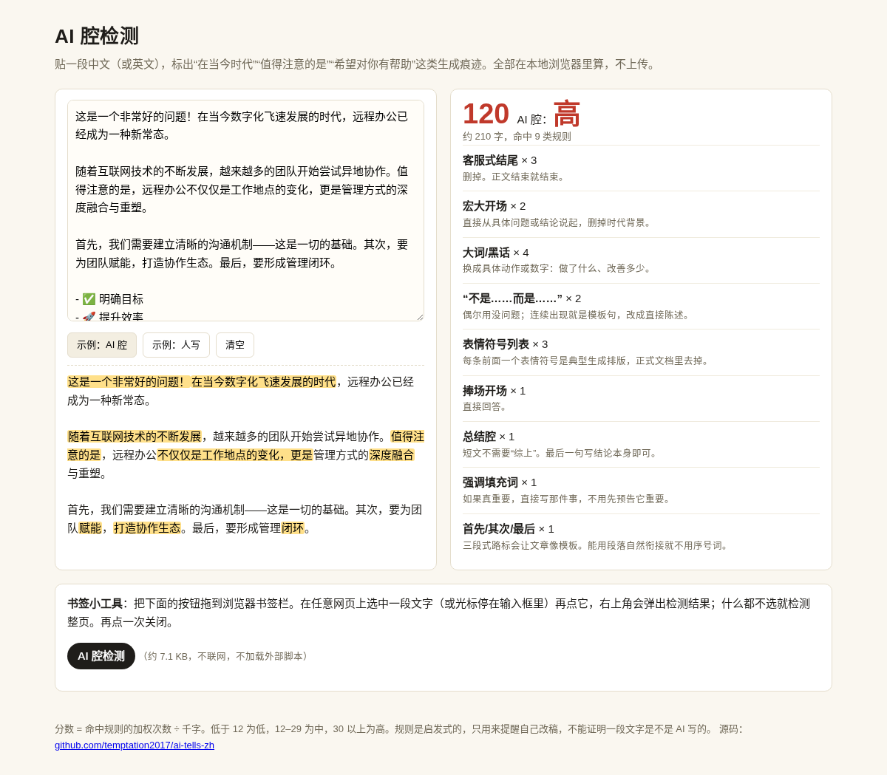

# ai-tells-zh · AI 腔检测

> 贴一段中文，标出“在当今时代”“值得注意的是”“希望对你有帮助”这类生成痕迹。网页、书签小工具、命令行三种用法，零依赖，不上传。

在线使用：<https://temptation2017.github.io/ai-tells-zh/>



## 做什么

AI 写的稿子常有一些固定的“腔”：宏大开场、强调填充词、“不是……而是……”、首先其次最后、表情符号列表、客服式结尾。英文圈有不少检测这类“AI tells”的清单，中文的少。这个小工具把常见的中文套话整理成规则，帮你在发周报、公众号、PR 描述、简历之前自查一遍。

它不判断“是不是 AI 写的”，只指出哪里读起来像模板，并给一句改法。

## 三种用法

### 1. 网页

打开 [在线页面](https://temptation2017.github.io/ai-tells-zh/)，或者下载仓库后直接双击 `index.html`（不需要服务器）。粘贴文字即可，右侧出分数和命中规则，左下方预览里高亮命中的片段。

### 2. 书签小工具

在网页底部把“AI 腔检测”按钮拖到浏览器书签栏。之后在任意网页：

- 选中一段文字再点书签：检测选中的部分
- 光标停在输入框或编辑器里再点：检测输入框内容（适合发帖前）
- 什么都不选：检测整个页面

右上角弹出结果，再点一次关闭。书签约 7 KB，代码全在书签里，不加载任何外部脚本。

### 3. 命令行（Node.js 14+）

```bash
git clone https://github.com/temptation2017/ai-tells-zh.git
cd ai-tells-zh
node cli.js examples/ai-style.md          # 检测文件
cat 周报.md | node cli.js                 # 从标准输入读
node cli.js docs/*.md --json              # 输出 JSON
node cli.js README.md --max 30            # 分数超过 30 时退出码为 1，可放进 CI 或提交钩子
```

示例输出：

```
examples/ai-style.md  约 210 字  得分 120  AI 腔：高
  [客服式结尾] ×3  删掉。正文结束就结束。
     第 11 行：…而是一场深刻的组织变革。希望以上内容对你有所帮助！如果你还有其他问题，欢…
  [宏大开场] ×2  直接从具体问题或结论说起，删掉时代背景。
     第 1 行：这是一个非常好的问题！在当今数字化飞速发展的时代，远程办公已经成为一种新…
  ...
examples/plain.md  约 126 字  得分 0  AI 腔：低
  没发现常见套话。
```

## 规则

| 规则 | 例子 |
|------|------|
| 宏大开场 | 在当今……的时代、随着……的快速发展 |
| 总结腔 | 总而言之、综上所述、归根结底 |
| 强调填充词 | 值得注意的是、毋庸置疑、众所周知 |
| 大词/黑话 | 赋能、抓手、闭环、底层逻辑、深度融合 |
| “深入探讨” | 深入探讨、让我们一起、揭开面纱 |
| 不是……而是…… | 不是 A，而是 B；不仅是 A，更是 B |
| 客服式结尾 | 希望对你有所帮助、如果还有其他问题、欢迎随时提问 |
| AI 自称 | 作为一个 AI 语言模型、我无法访问互联网 |
| 捧场开场 | 这是一个非常好的问题！、你说得对！ |
| 首先/其次/最后 | 三段式路标同时出现 |
| 破折号密度 | 每千字超过 3 个 |
| 表情符号列表 | 3 行以上以表情符号开头的列表 |
| 加粗过多 | 每千字超过 6 处 `**加粗**` |
| 英文常见 AI 词 | delve、tapestry、seamless、I hope this helps |

分数 = 命中规则的加权次数 ÷ 千字（文本不足 300 字按 300 字算，避免一句话就满分）。低于 12 为低，12–29 为中，30 以上为高。

## 文件

| 文件 | 说明 |
|------|------|
| `tells.js` | 规则和打分，浏览器、书签、Node 共用 |
| `panel.js` | 书签的浮层界面 |
| `index.html` | 网页版，书签也在这里生成 |
| `cli.js` | 命令行 |
| `test/run.js` | 自测：`node test/run.js` |
| `examples/` | 虚构的 AI 腔样例和人写样例 |

## 限制

- 规则是启发式的。人也会写“总而言之”，模型也能写得很干净，所以分数只是改稿提示，不能当证据。
- 只认固定词组和句式，不做语义分析；同义改写能绕过。
- 部分网站的内容安全策略（CSP）会禁止书签脚本运行，这时用网页版粘贴即可。

## 后续可改进

- 规则支持用户自定义（本地 JSON）
- 浏览器扩展版，在输入框旁实时提示
- 按文体（周报、公众号、技术文档）分别设阈值

欢迎提 issue 补充你见过的套话。

## 许可

MIT
